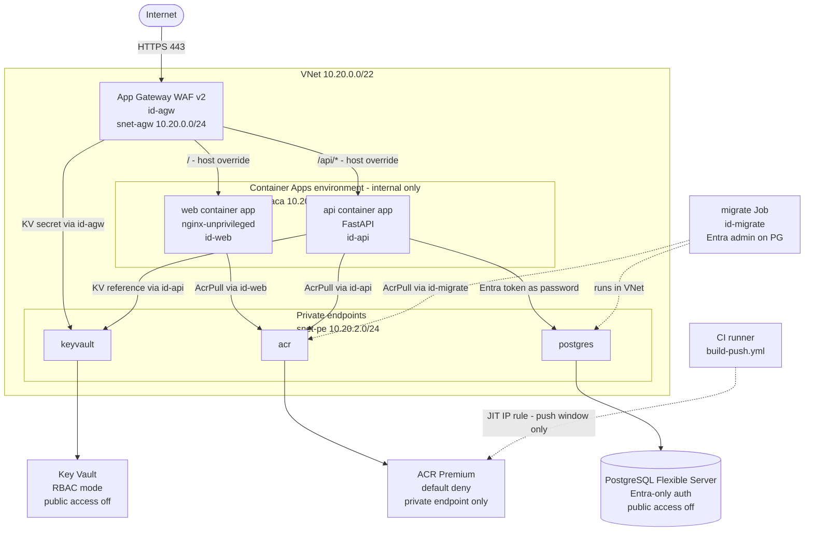

# secure-container-apps-terraform

A private three-tier app on Azure Container Apps built from hand-written Terraform modules.
Every module is custom - no Azure Verified Modules or third-party registry modules - to
demonstrate module design, input validation, secure defaults, and testing. The architecture
has no public data-plane exposure: Container Apps run in an internal environment behind an
Application Gateway WAF, all PaaS services connect through private endpoints, and all
identities are managed identities with no passwords or client secrets anywhere.

The sibling repo `secure-aks-baseline-terraform` composes Azure Verified Modules. This repo
takes the opposite approach on purpose.

---

## Architecture diagram



---

## Why no secrets

This deployment has no passwords, no service principal client secrets, and no registry
credentials. Here is how each connection works without them:

| Connection | Mechanism |
|---|---|
| Container apps pull images from ACR | AcrPull role assigned to each app's managed identity. No `imagePullSecrets`. |
| API connects to PostgreSQL | `password_auth_enabled = false` on the server. The API calls `azure-identity` to get an Entra access token and passes it as the password. |
| Migration job creates the API database role | `id-migrate` is the Entra administrator. It runs `pgaadauth_create_principal` inside the private network. |
| Apps read Key Vault secrets | Key Vault secret references in the container app definition. The Container Apps runtime fetches secrets using the app's managed identity at startup. |
| App Gateway reads the TLS certificate | `id-agw` has Key Vault Secrets User on the certificate secret. App Gateway fetches it directly - Terraform never touches the private key. |
| CI pushes images to ACR | OIDC federated credentials on a service principal. The runner adds its public IP to ACR network rules for the push window and removes it immediately after, via an `if: always()` step. |
| Terraform reads and writes state | `use_azuread_auth = true` in the backend block. The identity running Terraform holds Storage Blob Data Contributor on the state storage account. Shared key access is disabled on the account. |
| GitHub Actions authenticates to Azure | OIDC (`azure/login` with `ARM_USE_OIDC=true`). No client secret is stored anywhere. |

---

## Security controls

| Control | Implementation | Location |
|---|---|---|
| No public data-plane on PostgreSQL | `public_network_access_enabled = false` | `modules/postgresql-flexible` |
| No public data-plane on Key Vault | `public_network_access_enabled = false` | `modules/key-vault` |
| ACR default-deny network rules | `default_action = "Deny"`, no IP rules at rest | `modules/container-registry` |
| Container Apps internal only | `internal_load_balancer_enabled = true` | `modules/container-apps-environment` |
| WAF in Prevention mode | `policy_settings { mode = "Prevention" }` | `modules/app-gateway-waf` |
| No admin user on ACR | `admin_enabled = false` | `modules/container-registry` |
| No password auth on PostgreSQL | `password_auth_enabled = false` | `modules/postgresql-flexible` |
| Containers run non-root | `run_as_non_root = true`, UID 1000 | `app/api/Dockerfile`, `app/web/Dockerfile` |
| Key Vault RBAC mode | `enable_rbac_authorization = true` | `modules/key-vault` |
| Managed identities, one per workload | User-assigned, scoped to the resource | `infra/envs/dev/main.tf` |
| State shared-key access disabled | `shared_access_key_enabled = false` | `bootstrap/main.tf` |
| State auth uses Entra ID | `use_azuread_auth = true` | `infra/envs/dev/backend.tf` |
| HTTPS enforced on App Gateway listener | Certificate from Key Vault via `id-agw` | `modules/app-gateway-waf` |
| Private DNS zones for all PaaS | Zone linked to VNet, no public resolution needed | `modules/private-dns-zone` |

---

## Module catalog

| Module | Responsibility | README |
|---|---|---|
| `network` | VNet, subnets with optional delegation, NSGs | [modules/network/README.md](modules/network/README.md) |
| `private-dns-zone` | Private DNS zone and VNet links | [modules/private-dns-zone/README.md](modules/private-dns-zone/README.md) |
| `private-endpoint` | Generic private endpoint and DNS zone group | [modules/private-endpoint/README.md](modules/private-endpoint/README.md) |
| `log-analytics` | Log Analytics workspace with retention | [modules/log-analytics/README.md](modules/log-analytics/README.md) |
| `key-vault` | Key Vault with RBAC, purge protection, private endpoint | [modules/key-vault/README.md](modules/key-vault/README.md) |
| `container-registry` | Premium ACR, deny-by-default, private endpoint | [modules/container-registry/README.md](modules/container-registry/README.md) |
| `postgresql-flexible` | PostgreSQL with Entra-only auth, private endpoint | [modules/postgresql-flexible/README.md](modules/postgresql-flexible/README.md) |
| `container-apps-environment` | VNet-integrated internal environment, wildcard DNS | [modules/container-apps-environment/README.md](modules/container-apps-environment/README.md) |
| `container-app` | One app: image, identity, ingress, probes, scale | [modules/container-app/README.md](modules/container-app/README.md) |
| `container-app-job` | Manually triggered job with identity and env vars | [modules/container-app-job/README.md](modules/container-app-job/README.md) |
| `app-gateway-waf` | WAF v2 policy, path-based routing, optional HTTPS | [modules/app-gateway-waf/README.md](modules/app-gateway-waf/README.md) |

---

## CI and deployment workflows

This repository separates CI (always runs) from deployment (manual reference only).

### Workflows that run automatically

`ci.yml` triggers on every pull request and push to `main`. It requires no Azure
credentials and no repository variables.

| Step | Tool | Fails on |
|---|---|---|
| Terraform fmt, init, validate, tflint | `hashicorp/setup-terraform`, `setup-tflint` | Any fmt or lint issue |
| Terraform test (all modules + root) | `terraform test` with `mock_provider` | Any failing assertion |
| Checkov config scan | `bridgecrewio/checkov-action` | Any unfixed finding |
| Trivy config scan | `aquasecurity/trivy-action` | HIGH or CRITICAL findings |
| API unit tests | `pytest` | Any failing test |
| Docker build + Trivy image scan | `docker/build-push-action` | HIGH or CRITICAL CVEs |
| Workflow lint | `rhysd/actionlint` | Any workflow syntax error |

SARIF results from Checkov and Trivy appear under the Security tab in GitHub Code Scanning
for public repositories. Both scans still run and gate the build on private repositories;
the SARIF upload is skipped to avoid permissions failures.

### Deployment workflows (manual reference only)

`plan.yml`, `build-push.yml`, `apply.yml`, and `drift.yml` exist as documented
reference workflows. They trigger only on `workflow_dispatch` and every job has:

```yaml
if: vars.AZURE_SUBSCRIPTION_ID != ''
```

This means they skip cleanly when triggered without configuration. To enable them,
set the following repository variables under Settings - Secrets and variables -
Actions - Variables:

| Variable | Example value | Purpose |
|---|---|---|
| `AZURE_SUBSCRIPTION_ID` | `00000000-...` | Enables deployment jobs; also passed to Terraform |
| `AZURE_TENANT_ID` | `00000000-...` | OIDC tenant |
| `AZURE_CLIENT_ID` | `00000000-...` | OIDC service principal (federated credential on the repo) |
| `TF_BACKEND_RESOURCE_GROUP` | `rg-tfstate-contoso` | State storage resource group |
| `TF_BACKEND_STORAGE_ACCOUNT` | `stcontosostate01` | State storage account name |
| `TF_BACKEND_CONTAINER` | `tfstate` | State blob container name |
| `ACR_NAME` | `acrgoalsdev01` | ACR registry name (for network-rule JIT) |
| `ACR_LOGIN_SERVER` | `acrgoalsdev01.azurecr.io` | ACR login server for image tags |
| `APP_NAME` | `goals` | Matches `var.app_name` in Terraform |

`apply.yml` additionally requires a GitHub Environment named `production` with
required reviewers configured. The reviewer gate fires before `terraform apply`.

---

## Prerequisites

- Azure CLI >= 2.65 and an active `az login` session
- Terraform >= 1.10 (`winget install Hashicorp.Terraform` or `brew install terraform`)
- tflint >= 0.55 with the azurerm ruleset
- An Azure subscription where you have Owner or Contributor + User Access Administrator

---

## Deploy step by step

### 1. Bootstrap state storage (run once)

```shell
cd bootstrap
cp terraform.tfvars.example terraform.tfvars
# Edit terraform.tfvars: set subscription_id and a globally unique storage_account_name
terraform init
terraform apply
# The output prints a ready-to-paste backend block - copy it into infra/envs/dev/backend.tf
```

### 2. First apply with placeholder images

Container apps require an image reference at create time, before any images exist in ACR.
The first apply uses a public placeholder image so Terraform can create the container app
resources. The real images are pushed and applied in steps 3 and 4.

```shell
cd infra/envs/dev
cp terraform.tfvars.example terraform.tfvars
# Edit terraform.tfvars: set subscription_id, tenant_id, and review defaults.
# Leave api_image and web_image at their placeholder values for now.
terraform init
terraform apply
```

The outputs include the ACR login server and the App Gateway public IP.

### 3. Build and push container images

Run `build-push.yml` from the Actions tab, or build locally:

```shell
ACR=<acr-login-server>     # from terraform output acr_login_server
az acr login --name <acr-name>
docker build -t "${ACR}/api:v1" app/api && docker push "${ACR}/api:v1"
docker build -t "${ACR}/web:v1" app/web && docker push "${ACR}/web:v1"
docker build -t "${ACR}/migrate:v1" app/migrate && docker push "${ACR}/migrate:v1"
```

### 4. Re-apply with real image tags

Update `terraform.tfvars` with the real image references, then re-apply:

```shell
# In terraform.tfvars:
#   api_image   = "<acr>.azurecr.io/api:v1"
#   web_image   = "<acr>.azurecr.io/web:v1"
#   migrate_image = "<acr>.azurecr.io/migrate:v1"
terraform apply
```

### 5. Run the migration job

```shell
az containerapp job start \
  --name "job-migrate-<app-name>-dev" \
  --resource-group "rg-<app-name>-dev"
```

### 6. Test the endpoint

The default listener is HTTP for demo use. Use `https://` if you configured a Key Vault
certificate via `tls_certificate_key_vault_secret_id`.

```shell
curl http://<app-gateway-public-ip>/health
curl http://<app-gateway-public-ip>/api/items
```

---

## Cost warning

The two main cost drivers are:

- **Application Gateway WAF v2**: fixed capacity unit charge regardless of traffic. At 2 capacity
  units the cost is roughly $180-220 per month in eastus2.
- **PostgreSQL Flexible Server**: the Burstable B1ms SKU costs roughly $15-25 per month. HA
  doubles this.

For a short demo, use `terraform destroy` to tear everything down immediately after the
walkthrough.

---

## Teardown

```shell
# Remove all infrastructure
cd infra/envs/dev
terraform destroy

# Remove the state storage (optional - you lose all state history)
cd ../../..
cd bootstrap
terraform destroy
```

---

## Design decisions and trade-offs

**Container Apps over VMs or AKS:** Container Apps removes cluster management overhead while
still providing VNet integration and workload profiles. It is the right fit when the workload
is a small number of HTTP services and jobs and the team does not need to manage node pools.
AKS is the better choice when workloads require custom admission controllers, DaemonSets, or
specific node configurations.

**Entra-only PostgreSQL:** Eliminating password auth removes the entire class of credential-
leakage incidents. The trade-off is that local development requires either a dev Postgres
container or an Entra-capable `psql` session. This repo accepts that trade-off and documents
the local setup in `app/api/README.md`.

**Migration job runs in-network:** The migration job needs the Entra admin role on PostgreSQL
to create the API's database role with `pgaadauth_create_principal`. Running it inside the
Container Apps environment means it reaches Postgres through the private endpoint and never
exposes the admin identity to a public endpoint or a CI runner with internet access.

**ACR deny-by-default plus JIT CI access:** Fully disabling the public endpoint on ACR
(Premium) blocks `docker push` from CI runners. The chosen design keeps the public endpoint
but sets `default_action = "Deny"` with no standing IP rules. The CI pipeline adds the
runner's IP for the push window and removes it in an `if: always()` cleanup step. This gives
the same security posture as a private-only registry for the steady state, while avoiding the
complexity of self-hosted runners or private build agents.

**Two-phase image deploy:** Container Apps requires a valid image reference when the resource
is created. Because ACR is private by default, Terraform cannot pull from it during the
initial apply. The solution is a first apply using a public placeholder (for example
`mcr.microsoft.com/dotnet/nanoserver:latest`) to create the infrastructure, then a
`build-push.yml` run to publish the real images to ACR, then a second apply to update the
image references. This pattern keeps Terraform as the single source of truth for container
configuration and avoids managing image tags outside of state.

**`/api` path prefix on the FastAPI router:** App Gateway does path-based routing with
`/api/*` forwarded to the API backend. By default, App Gateway forwards the original path
including the `/api/` prefix: a request for `/api/items` arrives at the API as `/api/items`.
Mounting the item routes under `APIRouter(prefix="/api")` inside FastAPI makes the routes
match without requiring App Gateway to strip the prefix. The `/health` route stays at the
root so App Gateway backend probes can hit it directly without the prefix.
